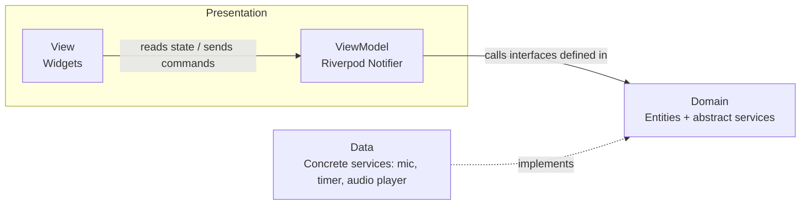

# Architecture

Music Tools follows **MVVM** (Model-View-ViewModel), organized **feature-first**
so that adding a new tool later never requires touching existing features.

## Layers



| Layer | Lives in | Responsibility | Depends on |
|---|---|---|---|
| **View** | `presentation/view/` | Flutter widgets. Renders the ViewModel's state, forwards user interaction as commands. No business logic, no direct access to `domain/` or `data/`. | ViewModel |
| **ViewModel** | `presentation/viewmodel/` | One per screen/feature. Exposes an immutable state object and command methods (e.g. `startListening()`). Orchestrates domain use cases and translates their output into UI state. Framework-agnostic where possible, which keeps it unit-testable without a widget tree. | Domain (via interfaces) |
| **Domain (Model)** | `domain/` | Pure Dart entities (`Pitch`, `Tempo`, ...) and the **interfaces** a ViewModel depends on (`PitchDetector`, `MetronomeTicker`, ...). No Flutter import, no plugin import. | Nothing |
| **Data** | `data/` | Concrete implementations of the domain interfaces, backed by real plugins/hardware (microphone, precise timer, audio playback). The only layer allowed to know about third-party packages. | Domain (implements its interfaces) |
| **Core** | `core/` | Cross-cutting code with no feature dependency: constants, shared error types, pure utilities. | Nothing |
| **Shared** | `shared/` | Presentation-only building blocks reused by more than one feature (widgets). | Nothing |

Depending on interfaces rather than concrete implementations (the domain
layer never imports a plugin) is what makes each ViewModel testable in
isolation: tests substitute a fake/mock implementation of the interface
instead of a real microphone or timer.

## Folder structure

```
lib/
├── app/                      # MaterialApp, theme, root widget — no business logic
├── core/                     # constants/, errors/, utils/ — shared, feature-agnostic
├── shared/                   # widgets/ — shared, presentation-only
└── features/
    ├── home/                 # tool registry / entry screen (the extensibility point)
    ├── tuner/
    │   ├── domain/
    │   ├── data/
    │   └── presentation/{view,viewmodel}/
    └── metronome/
        ├── domain/
        ├── data/
        └── presentation/{view,viewmodel}/
```

`test/` mirrors this structure 1:1, so any file's test lives at the
matching path under `test/`.

## Why Riverpod

The View↔ViewModel binding is implemented with
[flutter_riverpod](https://pub.dev/packages/flutter_riverpod):

- A ViewModel is a `Notifier<State>` (or `AsyncNotifier<State>` for
  asynchronous work, e.g. a pitch-detection stream), exposed through a
  `Provider`.
- A View only calls `ref.watch(...)` to read state and
  `ref.read(...).someCommand()` to trigger a command — it never touches
  `domain/` or `data/` directly.
- Concrete `data/` implementations are themselves exposed as providers, and
  injected into ViewModels through their `domain/`-level interface. Tests
  override these providers with fakes to exercise a ViewModel without a
  real microphone, timer, or audio device.

See [docs/adr/0001-mvvm-riverpod.md](adr/0001-mvvm-riverpod.md) for the full
decision record.

## Extensibility: adding a new tool

`features/home/` holds the registry of tools shown on the entry screen.
Adding a tool after Tuner and Metronome means:

1. Create `features/<tool>/` following the same `domain/` → `data/` →
   `presentation/` structure.
2. Register it in the home feature's tool list.

No existing feature file needs to change — this is the Open/Closed
Principle applied at the feature-folder level.

## Testing strategy

- **Domain**: plain unit tests on entities and use cases (no Flutter import
  needed).
- **ViewModel**: unit tests using `ProviderContainer`, overriding `data/`
  providers with fakes/mocks. This is where most business-logic tests live
  (pitch-to-note mapping, tempo/beat calculations, ...).
- **View**: `flutter_test` widget tests, wrapping the widget under test in
  a `ProviderScope` with overridden providers.
